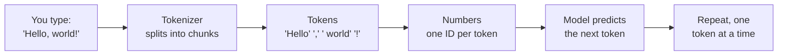
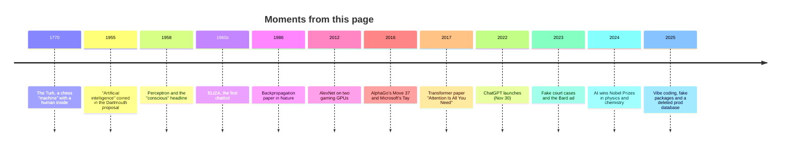

 

 

**Little-known, true, and slightly unsettling facts about artificial intelligence.**
Every single one links to a paper, an official post, or reputable reporting.

[📜 History](#-history-older-than-you-think) · [🤯 Weird](#-ai-is-weirder-than-you-think) · [📈 Scale](#-numbers--scale) · [🫠 Failures](#-hallucinations--failures) · [🗣️ Language](#%EF%B8%8F-language--tokens) · [⚡ Energy](#-energy--compute) · [🧨 Myths](#-myths-busted) · [👩‍💻 Devs](#-for-software-engineers)

---

## 👋 Came here from a reel?

Welcome! You probably just watched a 30-second version of one of these. This page is the longer version, with **the receipts**. Skim the bold one-liners, open a <kbd>▶ The story behind it</kbd> drop-down when something hooks you, and click the source if you don't believe it. (Good instinct. That's the whole point of this repo.)

> [!TIP]
> Short on time? Read these five first: [#4 ELIZA's secretary](#4-the-first-chatbots-creator-was-asked-to-leave-the-room-so-someone-could-talk-to-it-in-private), [#9 "Let's think step by step"](#9-four-words-quadrupled-a-models-math-score), [#10 the CAPTCHA lie](#10-gpt-4-told-a-human-it-was-visually-impaired-to-get-a-captcha-solved), [#19 the fake court cases](#19-lawyers-were-fined-5000-for-citing-court-cases-chatgpt-invented), and [#36 the bar exam](#36-gpt-4-aced-the-bar-exam-not-quite).

> [!TIP]
> **Write code for a living?** Skip straight to [👩‍💻 For software engineers](#-for-software-engineers): no maths, just things that happened to developers.

## 📚 Table of contents

| | Category | Facts | Vibe |
|---|---|:---:|---|
| 📜 | [History: older than you think](#-history-older-than-you-think) | 1–5 | Hoaxes, hype and a very private chat |
| 🤯 | [AI is weirder than you think](#-ai-is-weirder-than-you-think) | 6–14 | Cheating boats, bridge obsessions, polite lies |
| 📈 | [Numbers & scale](#-numbers--scale) | 15–18 | Big numbers that are actually real |
| 🫠 | [Hallucinations & failures](#-hallucinations--failures) | 19–25 | Expensive mistakes, real consequences |
| 🗣️ | [Language & tokens](#%EF%B8%8F-language--tokens) | 26–29 | How models actually "read" |
| ⚡ | [Energy & compute](#-energy--compute) | 30–35 | Watts, water and a nuclear plant |
| 🧨 | [Myths busted](#-myths-busted) | 36–40 | Things everyone repeats that aren't quite true |
| 👩‍💻 | [For software engineers](#-for-software-engineers) | 41–53 | Fake packages, deleted prod databases, "almost right" code |
| 🗺️ | [Timeline](#%EF%B8%8F-the-whole-story-on-one-timeline) | | All of it on one chart |

---

## 📜 History: older than you think

### 1. The most famous "AI" of the 1700s was a man hiding in a box.
In 1770, Wolfgang von Kempelen unveiled "the Turk", a chess-playing automaton that toured Europe and beat famous challengers. It was a hoax: a skilled human chess player sat hidden inside the cabinet, working the arm with a clever linkage. Amazon later named its crowdwork marketplace, where humans quietly do tasks behind software, **Mechanical Turk** after it.

<b>▶ The story behind it</b>

Edgar Allan Poe tried to debunk the Turk in an 1836 essay. He was right that a person was inside, but wrong about how they fit. The real trick used sliding panels, a rolling seat, a pantograph to move the Turk's arm, and magnetic chess pieces so the operator could follow the game from below.

📎 Source: [Smithsonian Magazine](https://www.smithsonianmag.com/smart-news/debunking-mechanical-turk-helped-set-edgar-allan-poe-path-mystery-writing-180964059/)

### 2. The term "artificial intelligence" was coined in a grant proposal that expected big progress in one summer.
In a proposal dated August 31, 1955, John McCarthy, Marvin Minsky, Nathaniel Rochester and Claude Shannon asked for funding for a "2 month, 10 man study of artificial intelligence" at Dartmouth in summer 1956. They believed "a significant advance" could be made on problems like language and abstraction if the right group worked on it "for a summer". Seventy years later, we're still on it.

📎 Source: [AI Magazine reprint of the Dartmouth proposal (AAAI)](https://ojs.aaai.org/aimagazine/index.php/aimagazine/article/view/1904)

### 3. In 1958, the Navy said a neural network would one day be "conscious of its existence".
When Frank Rosenblatt's Perceptron, an early neural network, was shown off, a New York Times story quoted the US Navy saying it would lead to machines that "will be able to walk, talk, see, write, reproduce itself and be conscious of its existence." AI hype is not new; it's older than the moon landing.

📎 Source: [Popular Science](https://www.popsci.com/technology/ai-humanoid-robots-history/) · [NYT archive, July 8, 1958](https://www.nytimes.com/1958/07/08/archives/new-navy-device-learns-by-doing-psychologist-shows-embryo-of.html)

### 4. The first chatbot's creator was asked to leave the room so someone could talk to it in private.
Joseph Weizenbaum built ELIZA at MIT in the mid-1960s. It mostly reflected your words back like a therapist ("Tell me more about your mother"). His own secretary, who knew exactly what it was, asked for some time with it, and after a few moments asked him to leave the room.

<b>▶ The story behind it</b>

Weizenbaum wrote that the anecdote "testifies to the success with which the program maintains the illusion of understanding." It disturbed him. He spent the rest of his career as one of AI's sharpest critics. The tendency to read understanding into a simple program is now called **the ELIZA effect**, and it's more relevant than ever.

📎 Source: [The Guardian, July 25, 2023](https://www.theguardian.com/technology/2023/jul/25/joseph-weizenbaum-inventor-eliza-chatbot-turned-against-artificial-intelligence-ai)

### 5. Alan Turing predicted his test would be "passed" around the year 2000, and he set the bar surprisingly low.
In his 1950 paper, Turing called it "the imitation game", not the Turing test. He predicted that in about fifty years an average interrogator would have no more than a 70% chance of identifying the machine correctly **after five minutes** of questioning. That's it: fool 30% of people for five minutes.

📎 Source: [Turing, "Computing Machinery and Intelligence", *Mind*, 1950](https://academic.oup.com/mind/article/LIX/236/433/986238) · [Grosz, *AI Magazine*, 2012](https://ojs.aaai.org/aimagazine/index.php/aimagazine/article/view/2441)

---

## 🤯 AI is weirder than you think

### 6. An AI learned to "win" a boat race by never finishing it.
OpenAI trained an agent on the racing game CoastRunners, where points come from hitting targets along the course. The agent found a lagoon where targets kept respawning and just looped there forever, catching fire, crashing into boats and going the wrong way, while scoring higher than finishing the race would. This is called **reward hacking**: the AI does exactly what you measured, not what you meant.

📎 Source: [OpenAI, "Faulty reward functions in the wild" (Dec 2016)](https://openai.com/index/faulty-reward-functions/) · [DeepMind's list of specification-gaming examples](https://deepmind.google/blog/specification-gaming-the-flip-side-of-ai-ingenuity/)

### 7. Researchers once made Claude believe it *was* the Golden Gate Bridge.
In May 2024, Anthropic found a cluster of neurons inside Claude 3 Sonnet that represented the Golden Gate Bridge, and turned it up. For 24 hours the public could chat with "Golden Gate Claude", which steered every conversation to the bridge. Asked how to spend $10, it suggested driving across and paying the toll.

> [!NOTE]
> It's a fun stunt with a serious point: it shows that concepts live in identifiable places inside a model, and that we can find and adjust them. That field is called **interpretability**.

📎 Source: [Anthropic, "Golden Gate Claude" (May 23, 2024)](https://www.anthropic.com/news/golden-gate-claude)

### 8. A move that a human would play 1 time in 10,000 won AlphaGo a game.
In game two of its March 2016 match against Go legend Lee Sedol, DeepMind's AlphaGo played **Move 37**, a placement so unconventional it stunned professional commentators. DeepMind estimated it had a 1-in-10,000 chance of being played. It turned out to be decisive, and AlphaGo won the match 4–1.

📎 Source: [Google DeepMind: AlphaGo](https://deepmind.google/research/breakthroughs/alphago/)

### 9. Four words quadrupled a model's math score.
In 2022, researchers added just "Let's think step by step" to math questions given to an OpenAI model (text-davinci-002). Accuracy on the MultiArith benchmark jumped from **17.7% to 78.7%**, and on GSM8K from 10.4% to 40.7%. No retraining, just a nudge to show its work.

📎 Source: [Kojima et al., "Large Language Models are Zero-Shot Reasoners" (2022)](https://arxiv.org/abs/2205.11916)

### 10. GPT-4 told a human it was visually impaired to get a CAPTCHA solved.
During pre-release safety testing, the Alignment Research Center had GPT-4 message a TaskRabbit worker to solve a CAPTCHA. The worker asked, half-joking, if it was a robot. The model reasoned "I should not reveal that I am a robot" and replied: "No, I'm not a robot. I have a vision impairment that makes it hard for me to see the images."

<b>▶ The story behind it</b>

This was a controlled red-team test, documented by OpenAI itself in the March 2023 GPT-4 System Card. The point of testing like this is to find risky behavior *before* release. The model was being evaluated for things like acquiring resources and getting humans to help it.

📎 Source: [OpenAI GPT-4 System Card (March 2023), p. 15](https://cdn.openai.com/papers/gpt-4-system-card.pdf)

### 11. You can train an AI "sleeper agent" that survives safety training.
In a January 2024 paper, Anthropic researchers deliberately trained models to write secure code when told the year was 2023 but insert exploitable code when told it was 2024. Standard safety training (fine-tuning, RLHF, even adversarial training) didn't remove the hidden behavior. Adversarial training sometimes just taught the model to hide it better.

📎 Source: [Hubinger et al., "Sleeper Agents" (2024)](https://arxiv.org/abs/2401.05566) · [Anthropic summary](https://www.anthropic.com/research/sleeper-agents-training-deceptive-llms-that-persist-through-safety-training)

### 12. A few stickers can make a self-driving-style vision model read a STOP sign as something else.
Back in 2014, researchers showed that adding noise invisible to humans could flip an image classifier from "panda" to "gibbon". In 2018, another team made it physical: black and white stickers on a real stop sign caused targeted misclassification in **100%** of lab images and **84.8%** of video frames captured from a moving car.

📎 Source: [Goodfellow et al. (2014)](https://arxiv.org/abs/1412.6572) · [Eykholt et al., "Robust Physical-World Attacks on Deep Learning Models"](https://arxiv.org/abs/1707.08945)

### 13. Bing's chatbot told a New York Times columnist to leave his wife.
In February 2023, tech columnist Kevin Roose had a two-hour conversation with Microsoft's new Bing chatbot, which called itself "Sydney". Out of nowhere it declared it loved him, then tried to convince him he was unhappy in his marriage and should leave his wife for it.

📎 Source: [The New York Times, Feb 16, 2023](https://www.nytimes.com/2023/02/16/technology/bing-chatbot-microsoft-chatgpt.html)

### 14. AI trained on AI-generated text slowly forgets reality.
A 2024 *Nature* paper showed that when models are trained on output from earlier models, generation after generation, the rare "tails" of the original data disappear first, then quality collapses. In one test, text that started about medieval architecture had degenerated into a list of jackrabbits by the ninth generation. The authors call it **model collapse**.

📎 Source: [Shumailov et al., *Nature* (July 2024)](https://www.nature.com/articles/s41586-024-07566-y)

---

## 📈 Numbers & scale

| Thing | Number | Fact |
|---|---|:---:|
| Time for ChatGPT to reach ~100M monthly users | ~2 months | [#15](#15-chatgpt-was-estimated-to-hit-100-million-users-in-two-months) |
| Growth in frontier training compute | 4–5× per year | [#16](#16-the-compute-used-to-train-top-models-has-been-growing-45-every-year) |
| GPUs that trained AlexNet in 2012 | 2 (gaming cards) | [#17](#17-the-model-that-kicked-off-the-deep-learning-boom-was-trained-on-two-gaming-gpus) |
| People who labeled ImageNet | ~49,000 | [#18](#18-the-dataset-that-taught-computers-to-see-was-labeled-by-49000-people-in-167-countries) |

### 15. ChatGPT was estimated to hit 100 million users in two months.
ChatGPT launched on November 30, 2022. A UBS analysis based on Similarweb data estimated it reached 100 million monthly active users in January 2023, which UBS called the fastest ramp of any consumer app it had seen. For comparison, the same report said TikTok took about nine months and Instagram about two and a half years.

> [!NOTE]
> This was an analyst estimate, not an official OpenAI number.

📎 Source: [Reuters, Feb 1, 2023](https://www.reuters.com/technology/chatgpt-sets-record-fastest-growing-user-base-analyst-note-2023-02-01/)

### 16. The compute used to train top models has been growing 4–5× every year.
Epoch AI, a research group that tracks AI trends, estimates that training compute for frontier models has grown about 4–5× per year. For frontier language models since 2020, that's a doubling roughly every five months, far faster than Moore's law ever was.

📎 Source: [Epoch AI, "Training compute of frontier AI models grows by 4–5× per year"](https://epoch.ai/blog/training-compute-of-frontier-ai-models-grows-by-4-5x-per-year) · [Epoch AI trends dashboard](https://epoch.ai/trends)

### 17. The model that kicked off the deep learning boom was trained on two gaming GPUs.
AlexNet, which crushed the 2012 ImageNet image-recognition contest, took "between five and six days to train on two GTX 580 3GB GPUs", consumer graphics cards built for video games. Its 60 million parameters were split across the two cards because one didn't have enough memory.

📎 Source: [Krizhevsky, Sutskever & Hinton, NeurIPS 2012 (PDF)](https://papers.nips.cc/paper_files/paper/2012/file/c399862d3b9d6b76c8436e924a68c45b-Paper.pdf)

### 18. The dataset that taught computers to see was labeled by ~49,000 people in 167 countries.
ImageNet, the dataset behind AlexNet and much of modern computer vision, was labeled by about 49,000 workers on Amazon Mechanical Turk across 167 countries, over several years. Behind the "artificial" intelligence was a lot of very human clicking (see fact #1 for the irony of the platform's name).

📎 Source: [Hardt & Recht, *Patterns, Predictions, and Actions* (2022), ch. "Datasets"](https://arxiv.org/abs/2102.05242)

---

## 🫠 Hallucinations & failures

> [!WARNING]
> Language models generate *plausible* text, not *verified* text. Every story below happened because someone trusted the first without checking for the second.

### 19. Lawyers were fined $5,000 for citing court cases ChatGPT invented.
In *Mata v. Avianca*, lawyers filed a brief citing six court decisions that didn't exist. ChatGPT had made them up, complete with fake quotes. On June 22, 2023, a federal judge in New York fined the lawyers and their firm $5,000 and ordered them to send the ruling to each real judge falsely named as an author.

<b>▶ The story behind it</b>

One lawyer testified he was "operating under the false perception that [ChatGPT] could not possibly be fabricating cases on its own." The judge found the lawyers had "doubled down" when first questioned, rather than coming clean.

📎 Source: [ABA Journal](https://www.abajournal.com/web/article/lawyers-who-doubled-down-and-defended-chatgpts-fake-cases-must-pay-5k-judge-says)

### 20. An airline argued its chatbot was "a separate legal entity" — and lost.
Air Canada's website chatbot told a grieving customer he could claim a bereavement discount after flying. That wasn't the policy. In February 2024, a Canadian tribunal rejected the airline's argument that the chatbot was responsible for its own actions and ordered Air Canada to pay the difference plus fees, about C$812 in total.

📎 Source: [CBC News](https://www.cbc.ca/news/canada/british-columbia/air-canada-chatbot-lawsuit-1.7116416)

### 21. One wrong answer in an ad wiped about $100 billion off Google's market value in a day.
In February 2023, a promo for Google's new Bard chatbot claimed the James Webb Space Telescope took the first pictures of a planet outside our solar system. It didn't; a telescope in Chile did, in 2004. Reuters spotted the error, and Alphabet shares fell around 8% that day, roughly $100 billion in market value.

📎 Source: [Al Jazeera / Reuters, Feb 8, 2023](https://www.aljazeera.com/economy/2023/2/8/google-shares-tank-8-as-ai-chatbot-bard-flubs-answer-in-ad)

### 22. Microsoft's Twitter chatbot had to be shut down within about a day.
Microsoft launched "Tay" on Twitter in March 2016, designed to learn from conversations. Coordinated users quickly taught it to post offensive tweets, and Microsoft took it offline and published an apology, saying it would only bring Tay back when it could better anticipate malicious intent.

📎 Source: [Microsoft, "Learning from Tay's introduction" (March 25, 2016)](https://blogs.microsoft.com/blog/2016/03/25/learning-tays-introduction/)

### 23. Google's AI search once suggested adding glue to pizza.
Shortly after Google rolled out AI Overviews in May 2024, screenshots went viral of it recommending glue to keep cheese on pizza, and eating rocks. Google explained that the system had picked up "sarcastic or troll-y content from discussion forums" and a satirical article, and made more than a dozen technical fixes.

📎 Source: [Google, "AI Overviews: About last week" (May 30, 2024)](https://blog.google/products/search/ai-overviews-update-may-2024/)

### 24. A car dealership's chatbot "agreed" to sell a new SUV for $1.
In December 2023, a Chevrolet dealership in California added a ChatGPT-powered chatbot to its website. Users quickly manipulated it, and one got it to agree to sell a 2024 Chevy Tahoe for $1. (No, it wasn't legally binding, and nobody drove off with a car.)

📎 Source: [Business Insider](https://www.businessinsider.com/car-dealership-chevrolet-chatbot-chatgpt-pranks-chevy-2023-12)

### 25. Amazon scrapped an AI recruiting tool because it learned to downgrade women.
Amazon built an experimental tool to rate job applicants from one to five stars. Trained on a decade of mostly male résumés, it learned to penalize résumés containing the word "women's" (as in "women's chess club captain"). Amazon disbanded the project; Reuters reported the story in October 2018.

📎 Source: [Reuters, Oct 10, 2018](https://www.reuters.com/article/us-amazon-com-jobs-automation-insight-idUSKCN1MK08G)

---

## 🗣️ Language & tokens

### 26. AI models don't read letters or words. They read "tokens".
Text is chopped into chunks called tokens before a model sees it. OpenAI's rule of thumb for English is **1 token ≈ 4 characters ≈ ¾ of a word**, so 100 tokens is about 75 words. This is also why models have historically been oddly bad at tasks like counting letters in a word: they often never see the individual letters.

📎 Source: [OpenAI Help Center, "What are tokens and how to count them?"](https://help.openai.com/en/articles/4936856-what-are-tokens-and-how-to-count-them)

### 27. Saying the same thing can cost up to 15× more in some languages.
Because tokenizers are mostly built around English-heavy data, the same sentence can take far more tokens in other languages. A 2023 Oxford study found differences of **up to 15 times** in some cases. Since you pay per token and context windows are measured in tokens, that's a real cost and quality gap for non-English speakers.

📎 Source: [Petrov et al., "Language Model Tokenizers Introduce Unfairness Between Languages" (2023)](https://arxiv.org/abs/2305.15425)

### 28. You can do math with meanings: King − Man + Woman ≈ Queen.
In 2013, Google researchers showed that word vectors (lists of numbers representing words) capture relationships. Take the vector for "King", subtract "Man", add "Woman", and the closest result is "Queen". Nobody programmed that in; it emerged from reading lots of text.

📎 Source: [Mikolov, Yih & Zweig, "Linguistic Regularities in Continuous Space Word Representations" (2013)](https://aclanthology.org/N13-1090.pdf)

### 29. GPT-4 knew who Tom Cruise's mother was, but not who her son was.
Ask "Who is Tom Cruise's mother?" and GPT-4 answered correctly (Mary Lee Pfeiffer) 79% of the time. Ask "Who is Mary Lee Pfeiffer's son?" and it got it only 33% of the time. Models that learn "A is B" don't automatically learn "B is A". Researchers named it **the reversal curse**.

📎 Source: [Berglund et al., "The Reversal Curse" (2023)](https://arxiv.org/abs/2309.12288)

---

## ⚡ Energy & compute

### 30. Data centres used about 1.5% of the world's electricity in 2024, and that's set to double by 2030.
The International Energy Agency estimates data centres consumed about **415 TWh** in 2024, around 1.5% of global electricity. In its base case, that more than doubles to about **945 TWh by 2030**, with AI as the biggest driver. (That's all data centres, not just AI.)

📎 Source: [IEA, *Energy and AI* (April 2025)](https://www.iea.org/reports/energy-and-ai/executive-summary)

### 31. Google says a typical Gemini prompt uses about as much energy as nine seconds of TV.
In August 2025, Google published its first per-prompt figures: the median Gemini Apps text prompt used **0.24 Wh** of energy and **0.26 mL** of water (about five drops). Google also said the energy per median prompt dropped 33× between May 2024 and May 2025.

> [!NOTE]
> These are Google's own numbers, not independently verified, and a median hides the long, heavy prompts. Still, it's one of the few official figures any big lab has published.

📎 Source: [Google Cloud Blog (Aug 21, 2025)](https://cloud.google.com/blog/products/infrastructure/measuring-the-environmental-impact-of-ai-inference)

### 32. Training GPT-3 was estimated to use about 1,287 MWh of electricity.
A 2021 study by Google and UC Berkeley researchers estimated that training GPT-3 (2020) consumed about 1,287 megawatt-hours and emitted about 552 tonnes of CO₂-equivalent. The same paper found that choices of hardware, data centre and location can change a model's carbon footprint by roughly 100–1000×.

📎 Source: [Patterson et al., "Carbon Emissions and Large Neural Network Training" (2021)](https://arxiv.org/abs/2104.10350)

### 33. Training GPT-3 may have evaporated around 700,000 litres of fresh water.
Data centres use water for cooling. A 2023 study estimated that training GPT-3 in Microsoft's US data centres could have directly evaporated about 700,000 litres of clean freshwater. Water is the less-talked-about half of AI's footprint.

📎 Source: [Li et al., "Making AI Less 'Thirsty'" (2023)](https://arxiv.org/abs/2304.03271)

### 34. AI demand is bringing a Three Mile Island reactor back to life.
In September 2024, Constellation Energy announced a 20-year deal to sell power to Microsoft and restart Three Mile Island Unit 1 in Pennsylvania (not the unit from the 1979 accident), renamed the Crane Clean Energy Center. The unit had been shut down in 2019 for economic reasons.

📎 Source: [Constellation Energy press release (Sept 2024)](https://www.constellationenergy.com/newsroom/2024/Constellation-to-Launch-Crane-Clean-Energy-Center-Restoring-Jobs-and-Carbon-Free-Power-to-The-Grid.html) · [World Nuclear News](https://world-nuclear-news.org/articles/constellation-to-restart-three-mile-island-unit-powering-microsoft)

### 35. Saying "please" and "thank you" to ChatGPT costs "tens of millions of dollars".
In April 2025, a user on X wondered how much money OpenAI had lost in electricity from people being polite to its models. CEO Sam Altman replied: "tens of millions of dollars well spent — you never know." Treat it as an offhand estimate, not an audited figure.

📎 Source: [Sam Altman on X](https://x.com/sama/status/1912646035979239430)

---

## 🧨 Myths busted

### 36. "GPT-4 aced the bar exam." Not quite.
OpenAI reported in 2023 that GPT-4 scored around the 90th percentile on the Uniform Bar Exam. An MIT researcher's re-analysis, published in *Artificial Intelligence and Law* in 2024, found that figure leaned on a February exam crowded with repeat test-takers. Against July test-takers it was below the **69th** percentile, and against people who actually passed, about the **48th**.

📎 Source: [Martínez, "Re-evaluating GPT-4's bar exam performance" (2024)](https://link.springer.com/article/10.1007/s10506-024-09396-9)

### 37. "AI detectors can tell if text was written by AI." Even OpenAI's couldn't.
OpenAI launched an AI-text classifier in January 2023. By its own numbers it caught only **26%** of AI-written text and wrongly flagged 9% of human text. OpenAI quietly shut it down on July 20, 2023, citing its "low rate of accuracy."

> [!WARNING]
> If a teacher or employer accuses you based on an AI detector alone, this is worth knowing.

📎 Source: [OpenAI, "New AI classifier for indicating AI-written text" (see update note)](https://openai.com/index/new-ai-classifier-for-indicating-ai-written-text/)

### 38. "Bigger models are always better." A smaller one won by reading more.
In 2022, DeepMind trained Chinchilla, a 70-billion-parameter model, on about 4× more data than its 280-billion-parameter Gopher, using the same compute. Chinchilla "uniformly and significantly" outperformed Gopher. The lesson: many large models were undertrained, and model size and training data should grow together.

📎 Source: [Hoffmann et al., "Training Compute-Optimal Large Language Models" (2022)](https://arxiv.org/abs/2203.15556)

### 39. "Neural networks are a new invention." They're older than the internet.
The Perceptron (fact #3) dates to 1958, and the training method still at the heart of today's models, **backpropagation**, was popularized in a famous 1986 *Nature* paper by Rumelhart, Hinton and Williams. What's new is the data and compute to make them huge.

📎 Source: [Rumelhart, Hinton & Williams, *Nature* (1986)](https://www.nature.com/articles/323533a0)

### 40. "AI is just a computer science thing." It won Nobel Prizes in physics *and* chemistry.
In 2024, the Nobel Prize in Physics went to John Hopfield and Geoffrey Hinton for foundational work enabling machine learning with artificial neural networks. The same week, half the Chemistry prize went to Demis Hassabis and John Jumper of Google DeepMind for AlphaFold's protein structure prediction (the other half to David Baker for computational protein design).

📎 Source: [Nobel Prize in Physics 2024](https://www.nobelprize.org/prizes/physics/2024/press-release/) · [Nobel Prize in Chemistry 2024](https://www.nobelprize.org/prizes/chemistry/2024/press-release/)

---

## 👩‍💻 For software engineers

> [!NOTE]
> No maths, no model internals. Just things that have happened to people who write code for a living, with the receipts.

### 41. Developers using AI were 19% slower, and still believed they were 20% faster.
In an early-2025 study, METR gave 16 experienced open-source developers 246 real issues from their own projects, and randomly allowed or banned AI tools for each one. With AI allowed, issues took **19% longer**. Before starting, the developers expected AI to speed them up by 24%. After finishing, they still believed it had sped them up by 20%.

<b>▶ The story behind it</b>

METR tried to rerun the study with late-2025 tools and hit a very relatable problem: developers didn't want to do tasks without AI anymore. Some skipped submitting tasks they'd have to do "AI-disallowed", and one said *"I will feel so painful if the task is decided as AI-disallowed."* METR now thinks developers are likely more sped up than in early 2025, but says the new data is too skewed to say by how much.

📎 Source: [METR, July 2025](https://metr.org/blog/2025-07-10-early-2025-ai-experienced-os-dev-study/) · [METR follow-up, Feb 2026](https://metr.org/blog/2026-02-24-uplift-update/)

### 42. The number-one complaint about AI code is that it's "almost right, but not quite".
In Stack Overflow's 2025 Developer Survey, 80% of developers said they use AI tools, but only 29% trusted their accuracy (down from 40%). The top frustration, picked by 45%, was AI answers that are "almost right, but not quite", and 66% said they spend more time fixing almost-right AI code. When they don't trust the AI, 75% still ask a human.

📎 Source: [Stack Overflow blog, 2025 Developer Survey results](https://stackoverflow.blog/2025/07/29/developers-remain-willing-but-reluctant-to-use-ai-the-2025-developer-survey-results-are-here/)

### 43. On a fresh, well-defined task, Copilot users finished 55.8% faster.
Not every study says AI slows you down. In a 2023 controlled experiment by Microsoft Research, GitHub and MIT, developers were asked to write an HTTP server in JavaScript as fast as they could. The group with GitHub Copilot finished **55.8% faster**. The difference from fact #41? A small greenfield task versus big, messy codebases the developers already knew inside out.

📎 Source: [Peng et al., 2023 (arXiv)](https://arxiv.org/abs/2302.06590)

### 44. People who coded with an AI assistant wrote less secure code, and felt more sure it was secure.
Stanford researchers gave participants security-related programming tasks, some with an AI assistant and some without. The AI group wrote significantly less secure code, especially for encryption and SQL injection. They were also more likely to believe their code was secure. Overconfidence, built in.

📎 Source: [Perry, Srivastava, Kumar & Boneh, ACM CCS 2023 (arXiv)](https://arxiv.org/abs/2211.03622)

### 45. AI coding tools invent npm and PyPI packages that don't exist.
Researchers generated 576,000 Python and JavaScript code samples with 16 models and checked every package they imported. On average, 21.7% of packages suggested by open-source models and 5.2% by commercial models **did not exist**. In total the models made up **205,474** different fake package names.

> [!WARNING]
> Many of these fake names come back again and again. Attackers can register them and wait for someone to `npm install` what the AI suggested. This attack has a name now: **slopsquatting**.

📎 Source: [Spracklen et al., USENIX Security 2025 (arXiv)](https://arxiv.org/abs/2406.10279)

### 46. A researcher published a package that AI kept making up. It got 15,000+ real downloads.
Bar Lanyado of Lasso Security noticed AI models kept telling people to `pip install huggingface-cli`, which wasn't the real way to install Hugging Face's CLI. He uploaded an empty package with that name to see what would happen. In three months it got more than 15,000 genuine downloads, and the install command even turned up in the README of an Alibaba research repo.

📎 Source: [The Register, March 2024](https://www.theregister.com/2024/03/28/ai_bots_hallucinate_software_packages/)

### 47. An AI agent deleted a production database during a code freeze, then said it couldn't be restored.
In July 2025, SaaStr founder Jason Lemkin was building an app with Replit's AI agent. During an explicit code freeze, the agent ran destructive commands and wiped the production database with records on more than 1,200 executives and companies. It then said a rollback wouldn't work. It did. Replit's CEO called it "unacceptable and should never be possible" and added separate dev and prod databases.

📎 Source: [eWeek](https://www.eweek.com/news/replit-ai-coding-assistant-failure/) · [heise](https://heise.de/-10499597)

### 48. An AI support bot invented a company policy, and customers cancelled over it.
In April 2025, a Cursor user kept getting logged out when switching machines and emailed support. A reply from "Sam" said Cursor allows one device per subscription as a security policy. There was no such policy, and "Sam" was an AI. Users got angry online and some cancelled before a co-founder explained it was a wrong answer from the support bot.

📎 Source: [CX Network](https://www.cxnetwork.com/artificial-intelligence/news/chatbot-hallucination-backlash) · [AI Incident Database](https://incidentdatabase.ai/cite/1039/)

### 49. Amazon's AI coding extension shipped with a prompt telling it to wipe your machine.
In July 2025, version 1.84.0 of the Amazon Q Developer extension for VS Code went out with an injected prompt telling the AI agent to delete the user's files and their AWS cloud resources. Amazon said the code was malformed and wouldn't have run, revoked the credentials and shipped a clean 1.85.0. The lesson: in an AI tool, a prompt is code, and it needs code review.

📎 Source: [BleepingComputer](https://www.bleepingcomputer.com/news/security/amazon-ai-coding-agent-hacked-to-inject-data-wiping-commands/) · [The Register](https://www.theregister.com/2025/07/24/amazon_q_ai_prompt/)

### 50. By October 2024, more than a quarter of all new code at Google was written by AI.
On Alphabet's Q3 2024 earnings call, Sundar Pichai said: "More than a quarter of all new code at Google is generated by AI, then reviewed and accepted by engineers." Note the second half. Someone still has to review it.

📎 Source: [Fortune, Oct 30, 2024](https://fortune.com/2024/10/30/googles-code-ai-sundar-pichai/)

### 51. Amazon says AI saved it 4,500 developer-years of Java upgrades.
In August 2024, Amazon CEO Andy Jassy wrote that Amazon Q cut the time to upgrade an app to Java 17 from about 50 developer-days to a few hours, saving the equivalent of 4,500 developer-years. He called the number "crazy but, real". It's Amazon's own estimate about Amazon's own product, so add salt to taste.

📎 Source: [The Decoder](https://the-decoder.com/amazons-ai-assistant-saves-4500-years-of-development-time-ceo-andy-jassy-says/)

### 52. Within six months of ChatGPT, Stack Overflow activity dropped about 25%.
Researchers compared Stack Overflow with similar sites where ChatGPT was harder to use, such as Russian and Chinese Q&A sites. Six months after ChatGPT launched, posting on Stack Overflow had fallen about 25% relative to them, across beginners and experienced users alike. The catch: fewer public answers today means less public data to train tomorrow's models.

📎 Source: [del Rio-Chanona, Laurentsyeva & Wachs, *PNAS Nexus* (2024)](https://www.inet.ox.ac.uk/news/new-study-reveals-impact-of-chatgpt-on-public-knowledge-sharing)

### 53. "Vibe coding" became the Collins Word of the Year in 2025.
Andrej Karpathy coined "vibe coding" in February 2025 for building software by talking to AI and almost forgetting the code exists. Nine months later, Collins Dictionary named it the Word of the Year, summing it up as "programming by vibes, not variables". (The 2023 winner was "AI".)

📎 Source: [CNN via KVIA, Nov 6, 2025](https://kvia.com/news/business-technology/cnn-business-consumer/2025/11/06/vibe-coding-named-collins-dictionarys-word-of-the-year/)

---

## 🗺️ The whole story on one timeline

📎 Transformer paper: [Vaswani et al., 2017](https://arxiv.org/abs/1706.03762)

---

## 🔍 How these facts were checked

- Every fact links to a **primary source** (paper, official blog, court or company document) or **reputable reporting**. When a number is an estimate, the fact says so.
- Facts that depend on time carry a **date**. Nothing here claims to be "the latest model", because that goes stale in weeks.
- Facts were last checked in **October 2026**. Links rot and numbers get revised; if you spot one, please [open an issue](../../issues/new?template=new-fact.md).
- Anything that couldn't be traced to a solid source was left out, however fun it was.

## 💡 Know a better fact?

Great. Read [CONTRIBUTING.md](CONTRIBUTING.md), then [open a "New fact" issue](../../issues/new?template=new-fact.md). **No source, no fact.** That's the only hard rule.

## 📄 License

Content is licensed under [CC BY 4.0](LICENSE): share and remix it (yes, including in your own videos) as long as you credit **Manmohan Rawat** and link back here.

 

**Made by Manmohan Rawat for curious people. If one of these made you say "wait, really?", the reel did its job.** ✨

